# kinetik — the motion library for web & mobile

**71 animated components · 10 page blocks · 6 mobile flows.** Copy-paste source (shadcn registry), live previews, and an **AI prompt** for every piece — organized like Refero and Mobbin, distributed like 21st.dev.

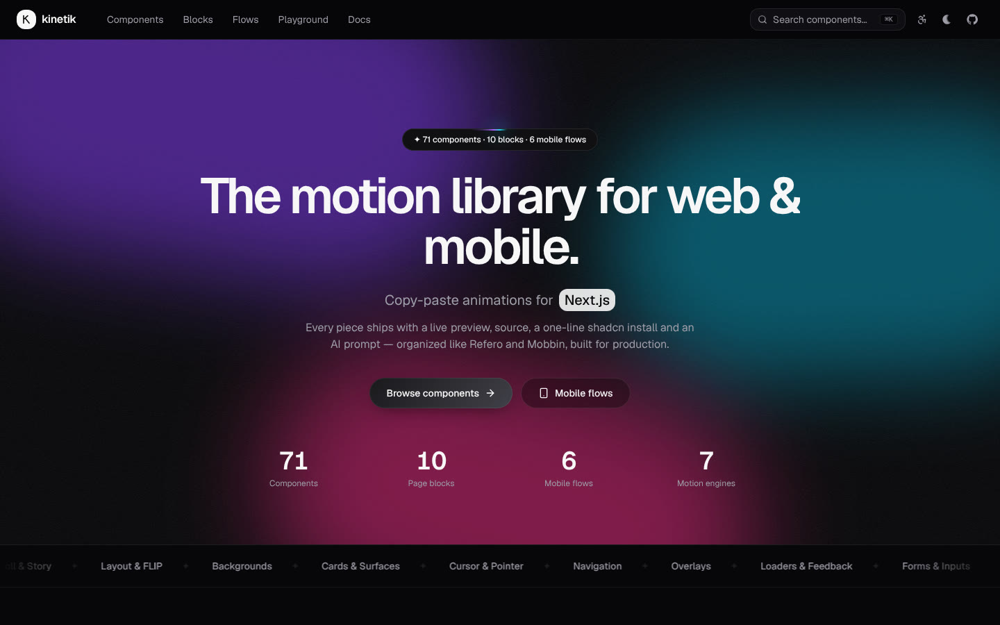

Every item ships with:

- a **live, interactive preview** (replay, desktop/tablet/mobile viewports, light/dark, and a **Reduce motion** toggle that shows the accessible fallback)
- **source + usage** with syntax highlighting
- a one-line **install**: `npx shadcn@latest add https://marvzkineticlibrary.vercel.app/r/<id>.json`
- a **Copy AI prompt** button — intent, motion spec, a11y/perf constraints, full source and helpers, ready for Claude Code, Cursor, v0, Bolt or Lovable
- props table, accessibility and performance notes, engine badge, similar items

## See it move

These GIFs are real recordings of the live previews (`scripts/record-gifs.mjs`).

| | | |
|---|---|---|
| 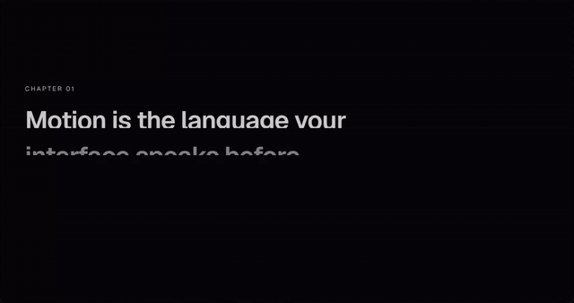 <br> **Split Text Reveal** · GSAP SplitText | 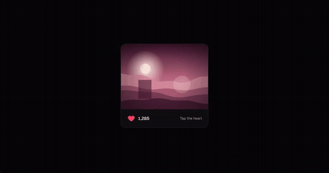 <br> **Like Burst** · Motion | 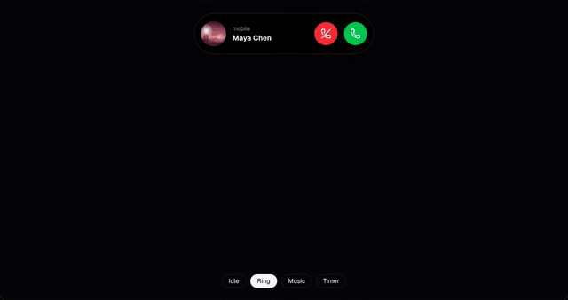 <br> **Dynamic Island** · Motion |
| 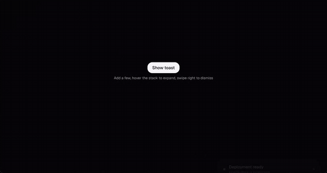 <br> **Toast Stack** · Sonner-style | 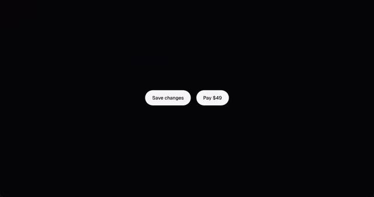 <br> **Stateful Button** | 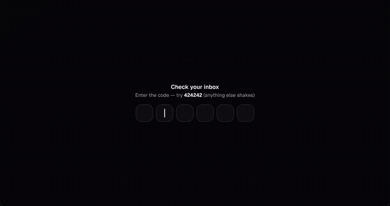 <br> **OTP Input** · shake on error |
| 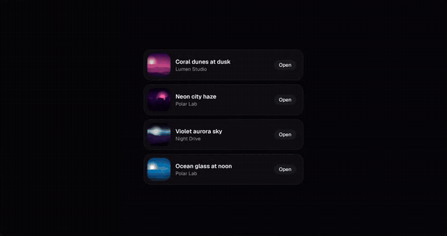 <br> **Expandable Card** · shared layout | 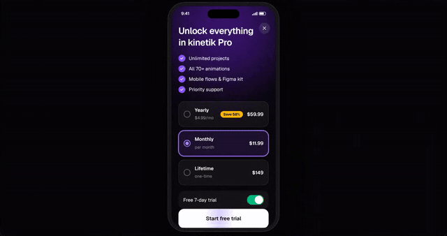 <br> **Paywall** · mobile flow | 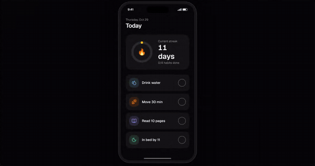 <br> **Habit Check-in** · mobile flow |

## What's inside

| Section | What you get |
|---|---|
| **[Components](apps/docs/app/components)** (71) | Text (split reveal, scramble, typewriter, rotate, ticker, shimmer, gradient, scroll highlight, marker) · Buttons & micro-interactions (press, shimmer, magnetic, border beam, stateful, hold-to-confirm, like burst, copy, switch, checkbox, theme toggle with View-Transition circle reveal) · Scroll (CSS scroll-driven reveal & progress, parallax, sticky stacking cards, horizontal pinned gallery) · Layout/FLIP (tabs, accordion, expandable card, reorder, auto-animate list, Dynamic Island) · Backgrounds (aurora, mesh gradient, grid/dots, film grain, meteors) · Cards (spotlight borders, bento, animated beams) · Cursor (spotlight, 3D tilt) · Navigation (smart navbar, morphing menu, macOS dock) · Overlays (native `<dialog>` + `@starting-style`, draggable drawer, toasts, tooltips) · Loaders (skeleton, 8 spinners, progress bar/ring, success mark) · Data viz (KPI grid, line draw, bar grow) · Forms (floating label, OTP, stepper, error shake, password strength) · Media (marquee, drag carousel, image reveal) · Transitions (View Transitions shared element, push/pop stack) · SVG path draw · 3D canvas shell (R3F) · Foundations (Lenis smooth scroll, Motion provider) |
| **[Blocks](apps/docs/blocks)** (10) | Hero, animated bento features, logo cloud + testimonial wall, spotlight CTA, FAQ, pricing toggle, magic-code auth, dashboard shell, checkout with confetti, playful 404 — filterable by Refero page type |
| **[Mobile flows](apps/docs/flows)** (6) | Mobbin-style onboarding pager, paywall, phone sign-in, habit check-in, swipe-to-pay checkout, profile & settings — interactive phone prototypes with a screen strip, and prompts that rebuild them in **Expo + Reanimated 4 + Gesture Handler + expo-haptics** |
| **[Playground](apps/docs/components/playground.tsx)** | Easing & spring visualizer; copy values as CSS, Motion, GSAP or Reanimated |
| **⌘K search** | Fuzzy search over names, tags, engines and page types |

| Component page | Mobile flow with screen strip | Playground |
|---|---|---|
| 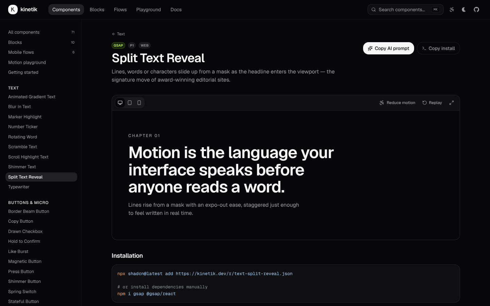 | 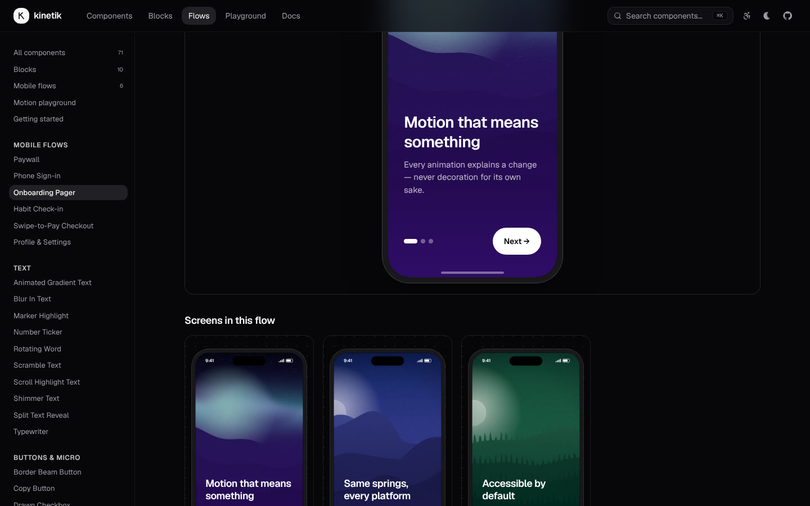 | 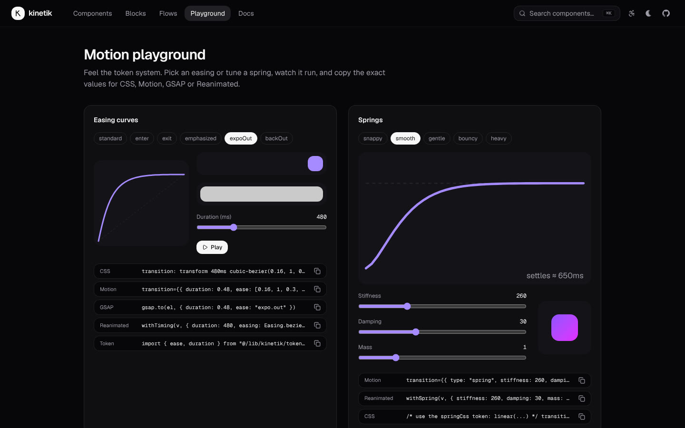 |

## One motion language

`packages/tokens` defines durations, easings, springs, distances and staggers once and exports them for CSS custom properties, Motion, GSAP, Anime.js and Reanimated (`springConfig` numbers are identical on web and native).

```ts
import { spring, duration, easeBezier } from "@/lib/kinetik/tokens";
<motion.div transition={spring.smooth} />            // { stiffness: 260, damping: 30, mass: 1 }
withSpring(v, reanimatedSpring.smooth)               // same physics on React Native
```

**Reduced motion is mandatory.** `useReducedMotion()` (in `packages/core`) is true when the OS prefers reduced motion *or* the app sets `<html data-reduce-motion>`. Every component swaps movement for opacity or an instant change; a Vitest suite renders every demo in both modes.

## Engine decision tree

CSS first (hover/press, `@starting-style`, scroll-driven animations) → View Transitions for route/shared-element changes → **Motion** for React state, layout and gestures → **GSAP** for choreography, SplitText, DrawSVG and ScrollTrigger → **Lenis** for smooth scroll → **R3F** for 3D (always lazy). See [/docs](apps/docs/app/docs/page.tsx) and [`motion-library-master-plan.md`](motion-library-master-plan.md).

## Repo layout

```
apps/docs/                 Next.js 16 gallery + docs (Tailwind v4, shiki)
  blocks/<page>/<slug>/    composed sections
  flows/<group>/<slug>/    mobile flow prototypes (phone frame)
  public/r/                generated shadcn registry + <id>.prompt.md
packages/tokens/           motion tokens (TS + kinetik.css)
packages/core/             hooks: useReducedMotion, useInView, usePrefersTouch, usePageVisible, cn
packages/web/src/<category>/<slug>/
  <slug>.tsx  <slug>.demo.tsx  <slug>.meta.ts  <slug>.prompt.md
scripts/gen-registry.mjs   gallery index, registry JSON, AI prompts
scripts/gen-demo-images.mjs  procedural, license-free demo art
scripts/record-gifs.mjs    README GIFs from live previews
```

## Develop

```bash
pnpm install
pnpm dev          # regenerates the registry, then runs the docs at http://localhost:3000
pnpm test         # contract + render tests for every component (normal & reduced motion)
pnpm typecheck
pnpm build
```

Add a component: create the four files in `packages/web/src/<category>/<slug>/`, run `pnpm registry`, and it appears in the gallery, ⌘K search, the registry and the prompt endpoints.

## Status

See [PROGRESS.md](PROGRESS.md) (every ID from the master plan), [DECISIONS.md](DECISIONS.md) and [CREDITS.md](CREDITS.md). Next phases: remaining P2/P3 web items, the native Expo gallery app (Section 8 source), Rive/Lottie players, and the MCP server.

MIT licensed.
